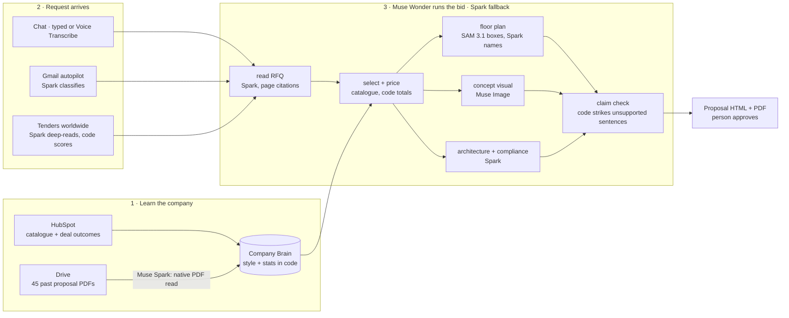
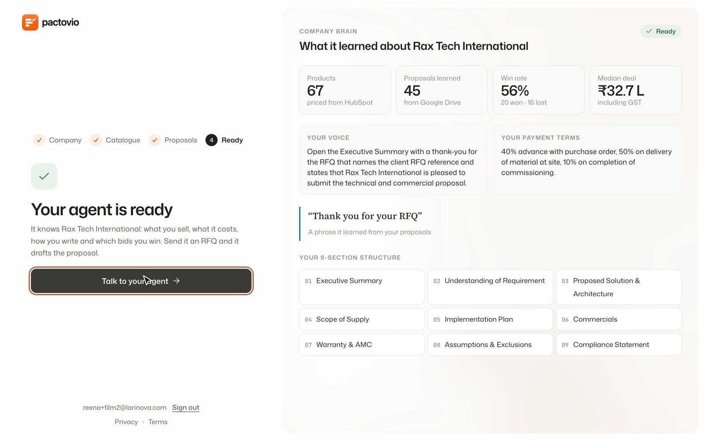
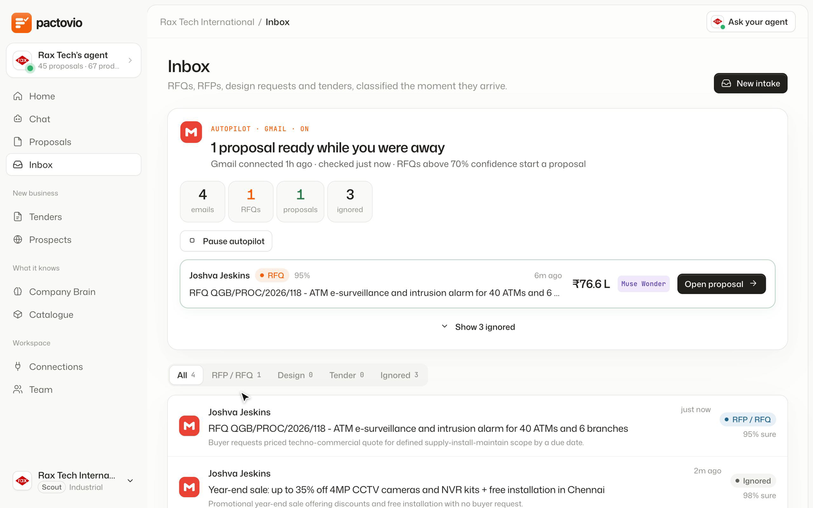
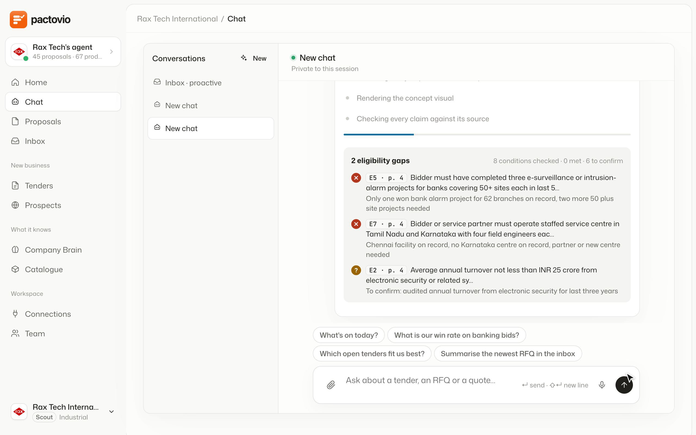
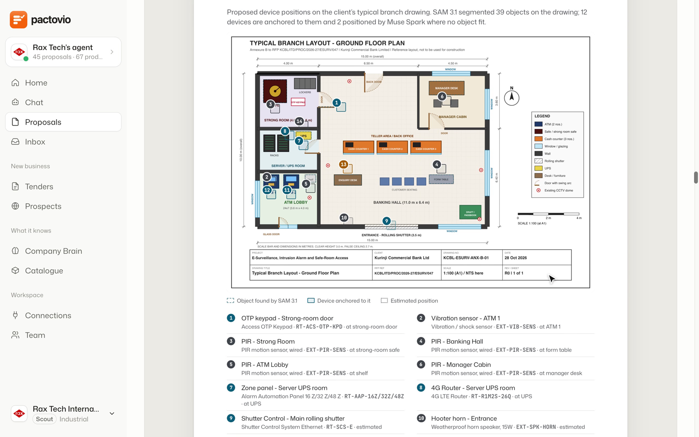
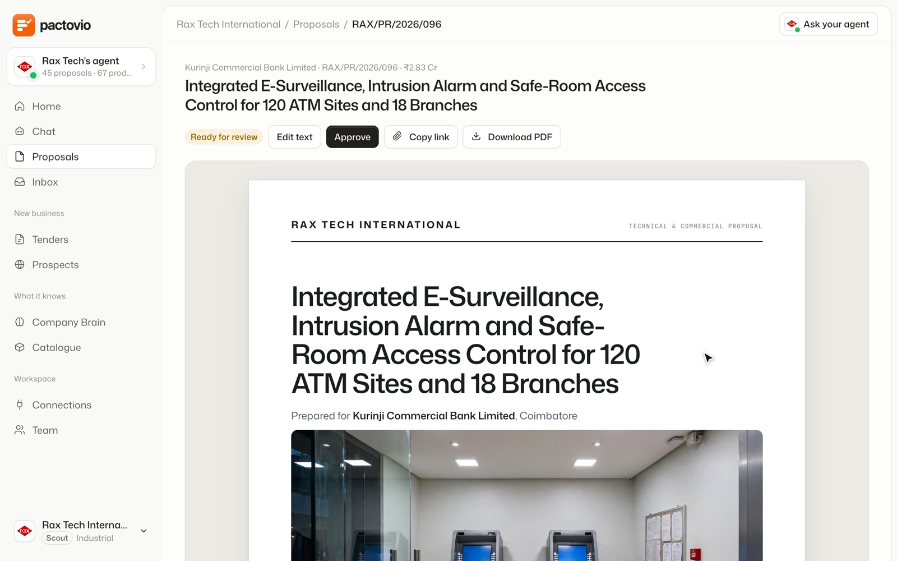
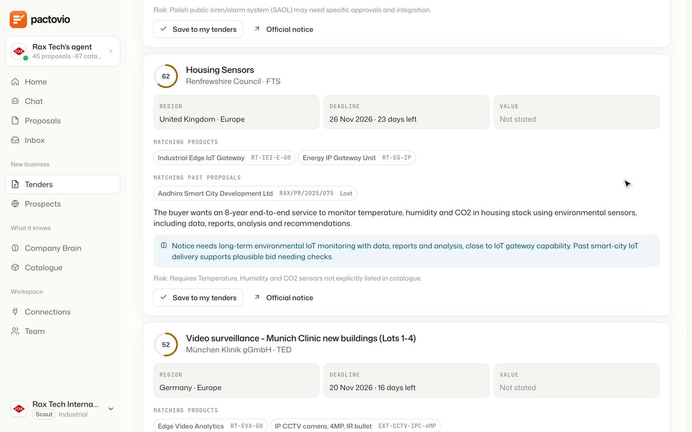
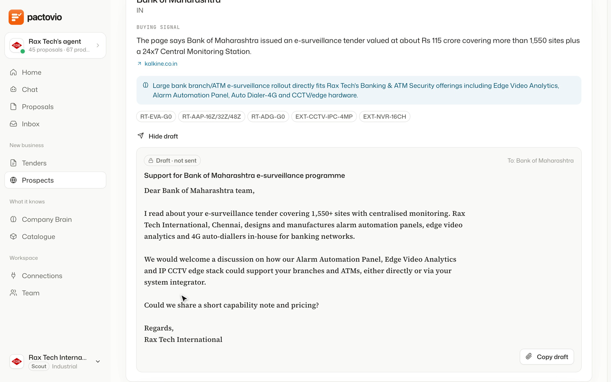

# Pactovio

[](https://github.com/BonneyMantra/pactovio-meta-hackathon/actions/workflows/ci.yml)
[](LICENSE)


**An AI bid desk for technical B2B suppliers.** Pactovio learns how a company wins from its past proposals and CRM. It reads a buyer's RFQ, then returns a priced, page-cited, evidence-checked proposal in the company's own voice. Nothing leaves until a person approves it.

**Live:** https://pactovio-meta.pages.dev (the product is at `/app`). **[One real run, traced](https://pactovio-meta.pages.dev/trace):** the timeline, models, tokens, cost and floor-plan placements of a production bid. Built for the Meta Global AI Developer Hackathon 2026, Startups Track.

Measured in production (read-only, 5 Nov 2026):

- **A full bid on five Meta models costs $0.39 and takes 7.2 minutes**, averaged over 13 runs.
- **Muse Wonder orchestrated all 13.**
- **Learning one past proposal costs $0.026.** Spark's reading of 45 past proposal PDFs matches the source records on **93.7%** of fields, and on **99.2%** of bill-of-materials lines ([eval](docs/EVALS.md#eval-how-accurately-muse-spark-reads-past-proposals)).
- **787 tests** run on every push.

Engineering docs: [Architecture](docs/ARCHITECTURE.md) · [Models and lanes](docs/MODELS.md) · [Evals and tests](docs/EVALS.md) · [Security](docs/SECURITY.md) · [Decision records](docs/adr/README.md) · [API](docs/API.md) · [Contributing](CONTRIBUTING.md)

## Architecture in 60 seconds



Every model call passes through one client (`packages/models`). That client chooses the model by role, adds reasoning headroom, enforces strict JSON, refuses contributor models, and meters spend against a hard daily cap with a kill switch. Code computes every price, score and verdict; models read and judge ([ADR 0003](docs/adr/0003-rubric-scored-in-code.md)).

## How Meta models power each stage

Costs are means over 13 completed production runs and 225 learned PDFs (read-only queries of `proposal_steps` and `brain_documents`, 5 Nov 2026). See [EVALS.md](docs/EVALS.md#measured-in-production).

| Stage | Meta model | Lane @ effort | Where in code | Measured cost |
|---|---|---|---|---|
| Learn a past proposal (native PDF → typed schema) | Muse Spark 1.3 | `reason` @low | `packages/brain/src/extract.ts` | $0.026 per PDF |
| House style (rules must cite ≥ 2 real proposals) | Muse Spark 1.3 | `reason` @medium | `packages/brain/src/style.ts` | once per learning run |
| Classify inbound mail (RFQ vs marketing) | Muse Spark 1.3 | `fast` @minimal | `packages/connectors/src/classify.ts` | answer capped at 400 tokens |
| Dictated request | Muse Voice Transcribe 1.0 | n/a | `packages/models/src/voice.ts` | $0.18 per audio hour |
| Orchestrate the bid (nine tools, ≤ 16 steps) | **Muse Wonder 1.0**, with Spark fallback | `meta:muse-wonder-1.0@medium` | `packages/models/src/wonder.ts`, `packages/proposal/src/orchestrate.ts` | $0.054 per run |
| Read the RFQ pack, page-cited requirements | Muse Spark 1.3 | `reason` @high | `packages/proposal/src/read.ts` | $0.071 |
| Eligibility, selection, architecture, compliance | Muse Spark 1.3 | `agent` @medium | `packages/proposal/src/{eligibility,select,design,compliance}.ts` | $0.133 |
| BoM narrative and work packages (prices in code) | Muse Spark 1.3 | `reason` @high | `packages/proposal/src/bom.ts` | $0.042 |
| Devices on the buyer's floor plan | **SAM 3.1** + Spark vision | `sam-3.1`, `vision` @medium | `packages/proposal/src/{floorplan,place}.ts` | $0.055 |
| Concept visual, captioned as generated | **Muse Image 1.0** (+ SAM 3.1 on ATM bids) | `muse-image-1.0` | `packages/proposal/src/visual.ts` | $0.038 |
| Claim check | none (code) | n/a | `packages/proposal/src/claims.ts` | $0 |
| **Full bid** | five models | | | **$0.39 mean** ($0.16–$0.54), 7.2 min |
| Tender fit (rubric scored in code) | Muse Spark 1.3 | `agent` @low | `apps/api/src/lib/opportunity-{assess,rubric}.ts` | cached 7 days per notice |
| Prospects with source links | Muse Spark `web_search` | `agent` @medium | `apps/api/src/lib/prospects.ts` | $2.50 per 1,000 searches |

The RFQ goes in as native PDF `file` and `image_url` parts with a 1,048,576-token window: no OCR, chunking or embeddings. `*-contributor` models are rejected in code (`packages/models/src/providers.ts:35`), because Meta may train on those prompts and proposals are commercial documents. Lanes are `LANE_<ROLE>=<provider>:<model>@<effort>` in `apps/api/wrangler.toml`. The registry also knows Fireworks, Baseten and Modal for open-weights deployments, but **every production lane is Meta**, and CI enforces that ([MODELS.md](docs/MODELS.md)).

## What it does, end to end

1. **Learns the company.** From its website, HubSpot (catalogue and deal outcomes) and Google Drive (past proposal PDFs). Muse Spark reads each proposal natively and extracts a typed schema; house style and win-rate statistics are computed from it. This is the **Company Brain** (`packages/brain`).
2. **Receives the request.** An RFQ arrives by chat (typed or dictated) or by Gmail **autopilot**, which classifies inbound mail, ignores the rest, and starts a run. Replies are drafts, never sent.
3. **Writes the bid.** Muse Wonder runs nine bid tools in order: read, eligibility, selection, BoM, architecture, floor plan, compliance, visual, claim check. The output has page-cited requirements, go/no-go, a priced bill of materials from the catalogue, architecture, zone wiring, devices placed on the buyer's floor plan (SAM 3.1), a compliance matrix, a labelled concept visual and a code-level claim check (`packages/proposal`).
4. **Review, edit, approve.** The proposal renders as designed HTML with PDF export. Nothing leaves without a person's approval.
5. **Finds more work.** Tenders from around the world are ranked against the Company Brain. Web search finds buyers with public buying signals and drafts outreach (`apps/api/src/routes/prospects.ts`).

### Design partner

Rax Tech International (Chennai; e-surveillance, IoT, automation; 49 products) is the company the workflow was built around. The imported HubSpot catalogue has 67 items (49 Rax products, 12 third-party components, 6 services). The agent learns from 45 past Rax proposals, with win or loss read from HubSpot deals: 20 won, 16 lost, 9 open.

## Screenshots

| | |
|---|---|
|  Company Brain: what it learned about Rax |  Gmail autopilot: proposal ready while you were away |
|  Run in chat: page-cited eligibility gaps |  Devices placed on the buyer's floor plan with SAM 3.1 |
|  The proposal, ready for review |  Tenders worldwide, ranked for Rax |
|  Prospects with source links and a drafted email | |

## How it works on Cloudflare

| Piece | Role |
|---|---|
| Worker `pactovio-meta-api` (`apps/api`) | Hono + zod routes for `/api`, `/mcp`, `/webhooks`. Cron `0 22 * * *` UTC (06:00 MYT) for the tender scan and a per-minute autopilot poll. |
| Workflows | `PackRunWorkflow`, `ScanWorkflow`, `IntakeWorkflow`, `BrainLearnWorkflow`, `ProposalRunWorkflow`: long runs that resume after failures. |
| Durable Object `AgentHub` | The chat agent: SQLite state, WebSocket, alarms, 17 tools, approval cards for state-changing actions; same tools over MCP. |
| D1, R2, KV, Queues | Records and run steps; pack files and proposal assets; cache and config; event fan-out. |
| Pages (`apps/front`) | `_worker.js` sends API paths to the Worker over a service binding and serves the static site and `/app`. |

Every model call is a row in `run_steps` (model, purpose, tokens in, out, cached, ms, cost). A **$20 per day** cap on model spend and a kill switch (`MODELS_DISABLED`, or KV key `config:models_disabled`) stop runaway cost. Budget exhaustion is an error, never a made-up answer.

Decisions are mostly code: gates, requirement status, go/no-go and pricing are computed in code, and the model writes reasoning. Every claim in a drafted answer is checked against evidence and unsupported sentences are struck.

Connectors run through Composio: Gmail, Outlook, Slack, Teams, HubSpot, Salesforce, Google Drive, Dropbox, calendars, Jira, Asana, DocuSign, QuickBooks and Xero. Each customer connects their own accounts to a private workspace. Sign-in is by six-digit email code.

## Engineering

- **CI** (`.github/workflows/ci.yml`) runs on every push with no secrets. It runs the repository guards, `tsc --noEmit` and 787 Vitest tests in 98 files ([EVALS.md](docs/EVALS.md)).
- **Real bindings in tests.** API tests run every D1 migration into a local D1, R2 and KV (Miniflare). Model replies are recorded wire-format payloads, so the whole pipeline, including the Wonder → Spark fallback, runs in a test.
- **Tenant isolation is tested.** More than 30 named tests show one workspace cannot read, write, export or enumerate another's data ([SECURITY.md](docs/SECURITY.md)).
- **Guards** (`scripts/ci-guards.sh`):
  - no contributor model in lane config
  - every production lane on Meta
  - no tracked env files or token-shaped secrets
  - no script targeting a retired deployment
  - LICENSE and CODEOWNERS present
- **Evals** (`packages/evals`, `scripts/evals`, [EVALS.md](docs/EVALS.md)):
  - Spark's reading of 45 past proposals: 93.7% of fields and 99.2% bill-of-materials F1 against the source records.
  - Production proposals scored in code: 0.96 overall, with 100% page citations, catalogue prices and arithmetic.
  - A live Wonder vs Spark orchestrator comparison.
- **Live progress.** `GET /api/proposals/:id/events` streams step telemetry as server-sent events, and the proposal screen falls back to polling ([API-STREAM.md](docs/API-STREAM.md)).
- **Durable runs.** Five Cloudflare Workflows with per-step retries. Proposal stages are idempotent and resume after a failure ([ADR 0004](docs/adr/0004-wonder-orchestrates-idempotent-tools.md)).

## Built during the hackathon

Development of Pactovio began on 30 Oct 2026, inside the hackathon window (26 Oct – 4 Nov 2026). We built on a tender pre-sales engine:

- **Company Brain**: HubSpot import, native read of past proposals, style and win-rate stats.
- **Bid engine**: the Wonder-run pipeline, SAM floor-plan placement, concept visual, claim check, HTML and PDF.
- **Autopilot**: Gmail classification, runs started from RFQs, "Proposal ready" in the Inbox.
- **Reach**: ranked worldwide tenders, web-search prospects and drafted outreach.

## What is not in this repository

The private, licensed UI kit source that the front end was designed with is not included. Only the compiled front end ships in `apps/front/public` (plain HTML, CSS and ES modules); it runs as is, but the original kit source and its licensed assets are not part of this repo.

## Run it locally

```bash
npm ci
npm run check                         # guards + typecheck + tests, as CI runs them
cd apps/api
# put META_API_KEY in .env.local (gitignored); dev.sh turns it into .dev.vars
PORT=8788 npm run dev                 # http://localhost:8788/api/health
```

Deploy: `wrangler deploy` for the Worker in `apps/api`, then `wrangler pages deploy public --project-name pactovio-meta` from `apps/front`. Connectors need a Composio project key and callback verifier; sign-in email needs a Resend key. See [customer setup](apps/api/CUSTOMER-AUTH.md), [API](docs/API.md) and [agent](docs/AGENT.md).

## Cut or not done

- Retrieval is lexical (idf-weighted term overlap), because Meta has no embedding model. It matches wording, not meaning.
- Billing is Dodo Payments test mode; no real payment is possible. There are no paying customers and no revenue.
- SAM 3.1 returns generic shapes on CAD line drawings. We prompt it with shape and colour phrases, then Muse Spark names each box.
- Muse Voice Transcribe is exercised in our tests with a software test input, not a native microphone.
- Muse Wonder is in preview; Spark takes over if it is unavailable.
- Scanned PDFs without a text layer are rejected on evidence upload; upload PNG or JPG.
- Several connectors (Outlook, Teams, QuickBooks, DocuSign, Xero) are built and fixture-tested but not live-tested.
- Open-weights lanes are configuration only (see Lanes).

## License

MIT.
