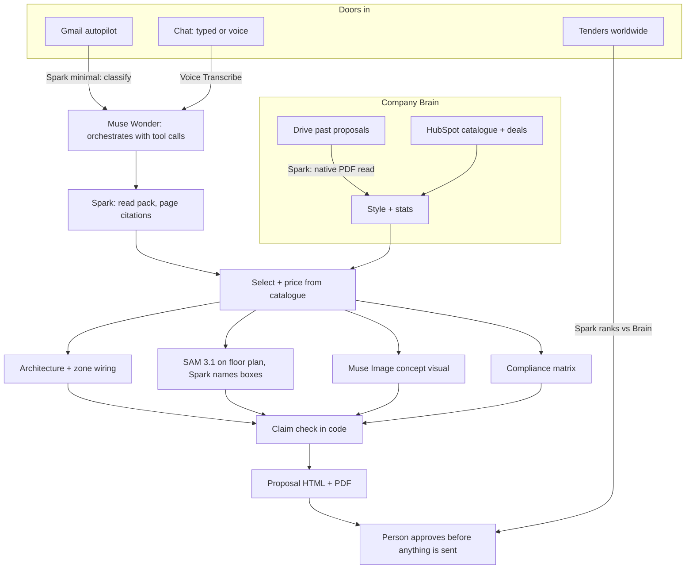

# Pactovio

The bid desk for technical B2B suppliers: it learns how a company wins, reads a buyer's RFQ, and returns a priced, evidence-backed proposal in the company's own voice, then waits for a person to approve it.

Live: https://pactovio-meta.pages.dev (landing, `/pricing`; the product is at `/app`). Built for the Meta Global AI Developer Hackathon 2026, Startups Track.

## What it does, end to end

1. **Learns the company.** From its website, HubSpot (catalogue and deal outcomes) and Google Drive (past proposal PDFs). Muse Spark reads each proposal natively and extracts a typed schema; house style and win-rate statistics are computed from it. This is the **Company Brain** (`packages/brain`).
2. **Receives the request.** An RFQ arrives by chat (typed or dictated) or by Gmail **autopilot**, which classifies inbound mail, ignores the rest, and starts a run. Replies are drafts, never sent.
3. **Writes the bid.** Muse Wonder runs the eight bid stages as tool calls. The output has page-cited requirements, go/no-go, a priced bill of materials from the catalogue, architecture, zone wiring, devices placed on the buyer's floor plan (SAM 3.1), a compliance matrix, a labelled concept visual and a code-level claim check (`packages/proposal`).
4. **Review, edit, approve.** The proposal renders as designed HTML with PDF export. Nothing leaves without a person's approval.
5. **Finds more work.** Tenders from around the world are ranked against the Company Brain. Web search finds buyers with public buying signals and drafts outreach (`apps/api/src/routes/prospects.ts`).

### Design partner

Rax Tech International (Chennai; e-surveillance, IoT, automation; 49 products) is the company the workflow was built around. The imported HubSpot catalogue has 67 items (49 Rax products, 12 third-party components, 6 services). The agent learns from 45 past Rax proposals, with win or loss read from HubSpot deals: 20 won, 16 lost, 9 open.

## Screenshots

| | |
|---|---|
|  Company Brain: what it learned about Rax |  Gmail autopilot: proposal ready while you were away |
|  Run in chat: page-cited eligibility gaps |  Devices placed on the buyer's floor plan with SAM 3.1 |
|  The proposal, ready for review |  Tenders worldwide, ranked for Rax |
|  Prospects with source links and a drafted email | |

## Architecture



## Which Meta model does what

Every model and search call goes to the Meta Model API. Prices are Standard-mode list prices.

| Model | Lane / id | Role | List price |
|---|---|---|---|
| Muse Spark 1.3 | `reason` `@high` | Native PDF and image read of the RFQ; requirements with filename and page; reads each past proposal | $1.25 in, $0.15 cached, $4.25 out per 1M tokens |
| Muse Spark 1.3 | `agent` `@medium`, `vision` `@medium`, `fast` `@minimal` | Chat tool loop, naming floor-plan boxes, email classification, tender ranking, drafting | same |
| Muse Spark web search | Responses API `web_search` | Prospects with public buying signals, with source links | $2.50 per 1,000 queries |
| Muse Wonder 1.0 | `meta:muse-wonder-1.0@medium` | Orchestrates the eight bid stages as tool calls (up to 16 steps); Spark fallback | $4.00 in, $0.20 cached, $20.00 out per 1M tokens |
| SAM 3.1 | `sam-3.1` | Segments floor plans and site photos so devices sit next to the real object | $2.50 per 1,000 images |
| Muse Image 1.0 | `muse-image-1.0` | Concept visual on the cover, captioned as generated | $0.01 per image |
| Muse Voice Transcribe 1.0 | `muse-voice-transcribe-1.0` | Spoken requests in chat | $0.18 per hour of audio |

The RFQ goes in as native PDF `file` and `image_url` parts with a 1,048,576-token window: no OCR, chunking or embeddings. Muse Spark counts reasoning tokens inside `max_tokens`, so the client adds headroom per effort level. `*-contributor` models are rejected in code, because Meta may train on those prompts and proposals are commercial documents. Code: `packages/models/src` (`providers.ts`, `wonder.ts`, `sam.ts`, `image.ts`, `voice.ts`).

## Lanes

Each role is `LANE_<ROLE>=<provider>:<model>[@effort]`, set in `apps/api/wrangler.toml`. Providers known to the registry: `meta`, `fireworks`, `baseten`, `modal`. The latter three speak the chat-completions protocol, so moving a role to an open-weights model on a customer's endpoint is a config change.

**This is architecture, not running.** Every lane in production is `meta:muse-spark-1.3`; nothing runs on Fireworks, Baseten or Modal.

## How it works on Cloudflare

| Piece | Role |
|---|---|
| Worker `pactovio-meta-api` (`apps/api`) | Hono + zod routes for `/api`, `/mcp`, `/webhooks`. Cron `0 22 * * *` UTC (06:00 MYT) for the tender scan and a per-minute autopilot poll. |
| Workflows | `PackRunWorkflow`, `ScanWorkflow`, `IntakeWorkflow`, `BrainLearnWorkflow`, `ProposalRunWorkflow`: long runs that resume after failures. |
| Durable Object `AgentHub` | The chat agent: SQLite state, WebSocket, alarms, 17 tools, approval cards for state-changing actions; same tools over MCP. |
| D1, R2, KV, Queues | Records and run steps; pack files and proposal assets; cache and config; event fan-out. |
| Pages (`apps/front`) | `_worker.js` sends API paths to the Worker over a service binding and serves the static site and `/app`. |

Every model call is a row in `run_steps` (model, purpose, tokens in, out, cached, ms, cost). A **$20 per day** cap on model spend and a kill switch (`MODELS_DISABLED`, or KV key `config:models_disabled`) stop runaway cost. Budget exhaustion is an error, never a made-up answer.

Decisions are mostly code: gates, requirement status, go/no-go and pricing are computed in code, and the model writes reasoning. Every claim in a drafted answer is checked against evidence and unsupported sentences are struck.

Connectors run through Composio: Gmail, Outlook, Slack, Teams, HubSpot, Salesforce, Google Drive, Dropbox, calendars, Jira, Asana, DocuSign, QuickBooks and Xero. Each customer connects their own accounts to a private workspace. Sign-in is by six-digit email code.

## Built during the hackathon

Development of Pactovio began on 30 Oct 2026, inside the hackathon window (26 Oct – 4 Nov 2026). We built on a tender pre-sales engine:

- **Company Brain**: HubSpot import, native read of past proposals, style and win-rate stats.
- **Bid engine**: the Wonder-run pipeline, SAM floor-plan placement, concept visual, claim check, HTML and PDF.
- **Autopilot**: Gmail classification, runs started from RFQs, "Proposal ready" in the Inbox.
- **Reach**: ranked worldwide tenders, web-search prospects and drafted outreach.

## What is not in this repository

The private, licensed UI kit source that the front end was designed with is not included. Only the compiled front end ships in `apps/front/public` (plain HTML, CSS and ES modules); it runs as is, but the original kit source and its licensed assets are not part of this repo.

## Run it locally

```bash
npm install
cd apps/api
# put META_API_KEY in .env.local (gitignored); dev.sh turns it into .dev.vars
PORT=8788 npm run dev                 # http://localhost:8788/api/health
cd ../.. && npm test && npm run typecheck
```

Deploy: `wrangler deploy` for the Worker in `apps/api`, then `wrangler pages deploy public --project-name pactovio-meta` from `apps/front`. Connectors need a Composio project key and callback verifier; sign-in email needs a Resend key. See [customer setup](apps/api/CUSTOMER-AUTH.md), [API](docs/API.md) and [agent](docs/AGENT.md).

## Cut or not done

- Retrieval is lexical (idf-weighted term overlap), because Meta has no embedding model. It matches wording, not meaning.
- Billing is Dodo Payments test mode; no real payment is possible. There are no paying customers and no revenue.
- SAM 3.1 returns generic shapes on CAD line drawings. We prompt it with shape and colour phrases, then Muse Spark names each box.
- Muse Voice Transcribe is exercised in our tests with a software test input, not a native microphone.
- Muse Wonder is in preview; Spark takes over if it is unavailable.
- Scanned PDFs without a text layer are rejected on evidence upload; upload PNG or JPG.
- Several connectors (Outlook, Teams, QuickBooks, DocuSign, Xero) are built and fixture-tested but not live-tested.
- Open-weights lanes are configuration only (see Lanes).

## License

MIT.
