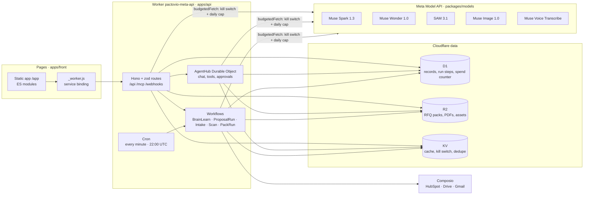
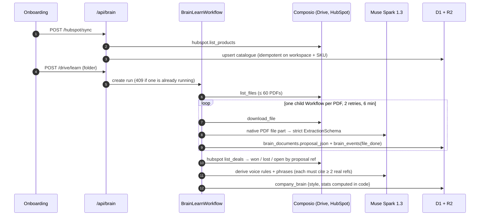
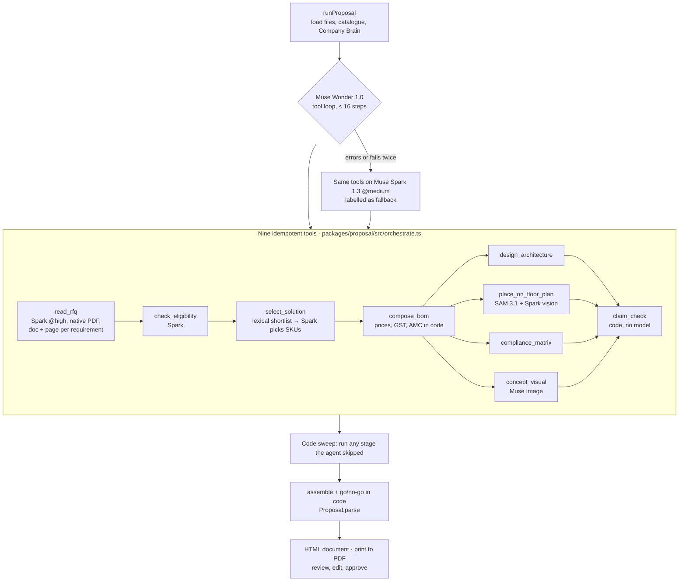
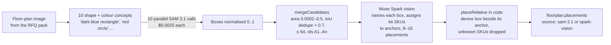
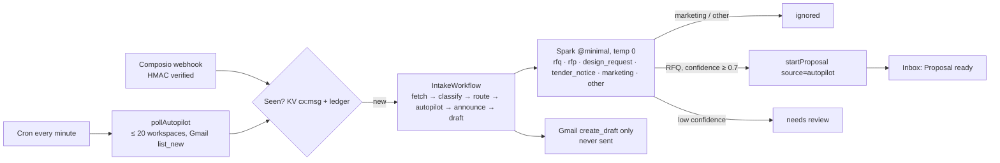
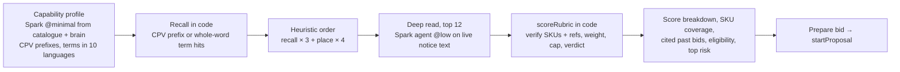

# Architecture

Pactovio runs on Cloudflare. It has one Worker for the API, the agent and the Workflows, and one Pages site for the front end. All inference runs on five Meta models through one client package. This page follows data through each workflow. Model configuration is covered in [MODELS.md](MODELS.md), the security boundaries in [SECURITY.md](SECURITY.md), and decision records in [adr/](adr/).

## System

| Piece | Code | Notes |
|---|---|---|
| Routes | `apps/api/src/routes/*.ts` (35 files) | Typed router: zod parses params, query and body, and errors return `{ error, code }` (`apps/api/src/lib/router.ts`) |
| Workflows | `apps/api/src/workflows/{brain,proposal-run,intake,scan,pack-run}.ts` | Durable steps with retries. A step that already finished is skipped on resume |
| Agent | `packages/agent/src`, Durable Object `AgentHub` | Chat tool loop on the `agent` lane. State-changing tools ask for approval first. The same tools are exposed over MCP (`apps/api/src/routes/mcp.ts`) |
| Model client | `packages/models/src` | Lanes, reasoning headroom, strict JSON, tool loop, Wonder, SAM, Image, Voice, spend cap |
| Domain packages | `packages/brain`, `packages/proposal`, `packages/connectors`, `packages/quote`, `packages/engine` | Pure TypeScript with D1, R2 and fetch injected, so the tests run them in Node against SQLite |
| Schema | `apps/api/migrations/*.sql` | D1 migrations, applied in order |

## 1. Company Brain: learning how the company wins

- **Extraction** (`packages/brain/src/extract.ts`, `schema.ts`). Each past proposal goes to Muse Spark as a native PDF `file` part: no OCR, chunking or embeddings. The reply is validated against a zod schema covering ref, client, solution type, scope of supply, custom engineering, commercials, compliance and outcome.
- **Outcomes** (`packages/brain/src/outcomes.ts`). A HubSpot deal name starts with the proposal ref. The deal stage overrides the outcome printed in the PDF, and the record keeps `outcome_source`.
- **Style** (`packages/brain/src/style.ts`). The model proposes voice rules and recurring phrases. `groundDraft` keeps only those cited by at least two real learned refs, and the run fails if fewer than three of each survive. Payment terms, warranty, AMC, validity and discount pattern are computed in code.
- **Stats** (`packages/brain/src/stats.ts`). These are computed only from the extracted data, never by a model: win rate, value bands, median value, mix by solution type, sector and region, top products and engineering days.
- **Progress** streams to the learning view from `brain_events` (`GET /api/brain/progress?after=seq`).

## 2. RFQ → proposal: Muse Wonder runs the bid

Entry points:

- Chat or upload: `POST /api/proposals`, with 8 files of 15 MB each and 30 runs per hour per workspace.
- Gmail autopilot: `apps/api/src/lib/autopilot-wiring.ts`.
- A tender's "Prepare bid": `apps/api/src/lib/opportunity-detail.ts`.

All three call `startProposal` (`packages/proposal/src/start.ts`). That function stores the files in R2 and starts `ProposalRunWorkflow`, which has one durable step, 1 retry and a 30-minute timeout (`apps/api/src/workflows/proposal-run.ts`).

What the model decides and what code decides (detail and line references in [adr/0003](adr/0003-rubric-scored-in-code.md)):

| Stage | Model | Code |
|---|---|---|
| `read_rfq` (`read.ts`) | Reads PDFs and images natively. Writes requirements with doc, page and clause | Caps at 60 requirements. Picks the floor-plan file |
| `check_eligibility` (`eligibility.ts`) | Gives met, to confirm or gap per eligibility row, using company facts | Selects which rows count as eligibility. Rows the model skipped default to "to confirm" |
| `select_solution` (`select.ts`) | Picks SKUs, scope and quantities from a shortlist | Builds the lexical shortlist (≤ 45 SKUs). Drops SKUs and past refs that are not real |
| `compose_bom` (`bom.ts`) | Writes the narrative, budgetary external items and work packages | Sets quantities × sites, catalogue unit prices, totals, GST, AMC and warranty. Clamps the discount to 0–15% |
| `design_architecture` (`design.ts`) | Writes nodes, links and the zone map | Drops dangling links and zones whose SKU is not in the supply |
| `compliance_matrix` (`compliance.ts`) | Judges the non-eligibility rows | Reuses the eligibility verdicts. Rows the model skipped become "partial" |
| `claim_check` (`claims.ts`) | none | Strikes any sentence whose figure, name, standard or date has no evidence |
| go/no-go (`gonogo.ts`) | none | Weighs coverage, win rate on similar past bids, deviations and deadline |

Every stage writes a `proposal_steps` row with its models, tokens, cost, milliseconds and summary. `GET /api/proposals/:id/events` streams those rows to the browser as server-sent events while the run is going (`apps/api/src/routes/proposal-events.ts`, protocol in [API-STREAM.md](API-STREAM.md)). The proposal screen refreshes when a step lands and falls back to polling on any stream error. A public page draws one finished run from the same rows: https://pactovio-meta.pages.dev/trace. It also saves the whole run state, so a Workflow retry resumes after the last finished stage (`packages/proposal/src/ctx.ts`).

### SAM 3.1 placement pipeline

SAM 3.1 on CAD line drawings does not respond to semantic prompts such as "ATM". The pipeline therefore splits the work: SAM finds shapes, Spark says what each shape is, and code places devices.

The code is in `packages/proposal/src/floorplan.ts`, `place.ts` and `packages/models/src/sam.ts`. For ATM bids the concept visual (`visual.ts`) also runs SAM, using 6 natural-language concepts on the generated lobby image. That image is always captioned "Concept visual — generated, not a product photo". The caption is a literal in the schema.

## 3. Gmail autopilot

- Polling covers 72 hours back, never earlier than the moment autopilot was switched on (`apps/api/src/lib/autopilot-poll.ts`, `autopilot-store.ts`).
- Idempotency comes from three things together: a KV key per message, a ledger query, and `INSERT OR IGNORE` on `apm_{intake}`.
- The classifier prompt treats email as untrusted (`packages/connectors/src/classify.ts`).
- The Gmail action catalogue has `create_draft` and no send action (`packages/connectors/src/catalog.ts`).

## 4. Tenders: deep, explainable fit

The model reads the notice and returns requirements with the SKUs it believes cover them, up to three similar past proposals, five eligibility checks, the deciding factor and the top risk. Code scores the result (`apps/api/src/lib/opportunity-rubric.ts`):

- Capability 40, track record 25, eligibility 20, commercial 15.
- Every cited SKU and past ref is checked against the workspace's own catalogue and brain, and invented ones are dropped.
- A "full coverage" claim with no real SKU is downgraded.
- The total is capped at 35 when coverage is below 30%.
- **Bid** needs overall ≥ 70, at most one risk and coverage ≥ 60%. **Bid with conditions** needs overall ≥ 50 and coverage ≥ 40%. Anything else is **Pass**.

## 5. Prospects

`apps/api/src/lib/prospects.ts` calls the Responses API with `tools: [{ type: 'web_search' }]` on the agent lane. A prospect is kept only if its `source_url` is one of the URLs the search actually returned. The others are counted as `dropped_without_source`. Outreach is stored as a draft and never sent.

## Cross-cutting

- **Spend.** All model traffic passes `budgetedFetch` or `metered`: kill switch, atomic reservation, then settlement ([MODELS.md](MODELS.md#budget-a-hard-daily-cap-and-a-kill-switch)).
- **Tenancy.** Every query binds the session's `workspace_id`. A foreign id returns 404 ([SECURITY.md](SECURITY.md)).
- **Telemetry.** `proposal_steps`, `run_steps` and `brain_events` record every model call with its model, tokens, cost and latency. The interface labels the model that ran from these rows.
